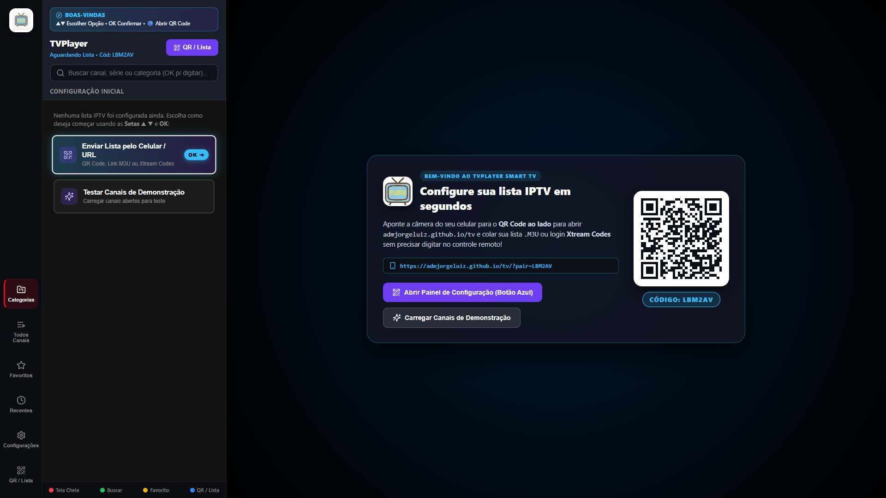
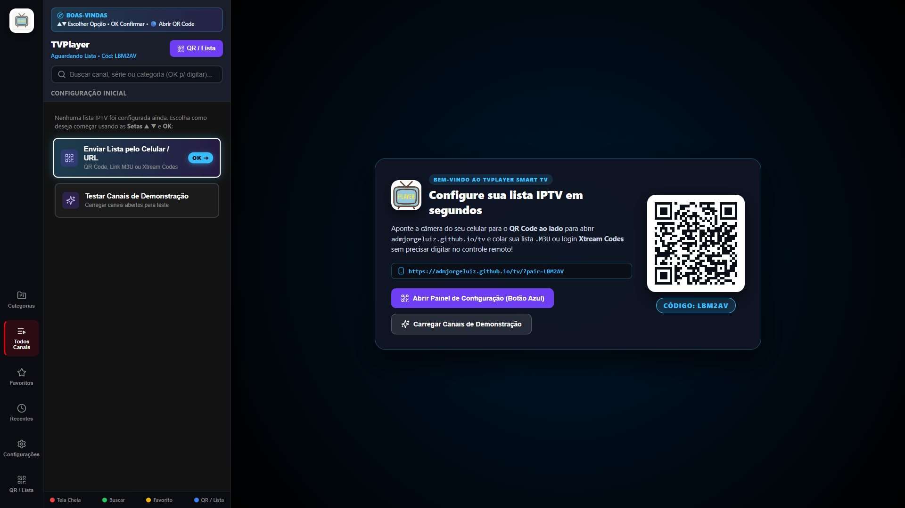
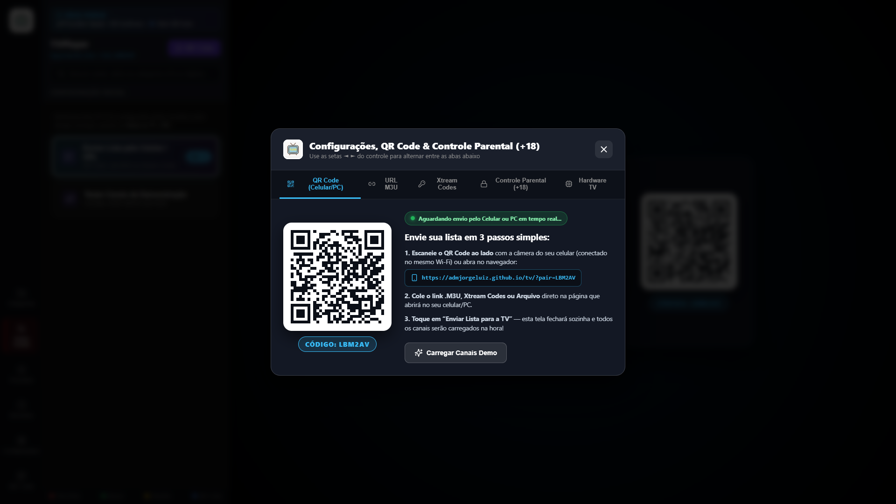
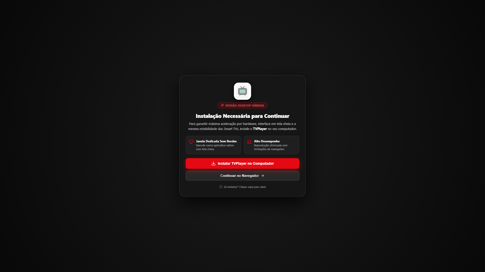

# TVPlayer Smart TV & Desktop (Samsung Tizen, LG webOS & PWA)

<p align="center">
  
</p>

<p align="center">
  <strong>Aplicativo híbrido IPTV moderno, de alta performance e interface inspirada na Netflix, desenvolvido para Smart TVs Samsung (Tizen OS), LG (webOS) e Desktop (Windows/PC via PWA).</strong>
</p>

<p align="center">
  
  
  
  
  
  
  
</p>

---

## 📸 Capturas de Tela

<div align="center">

### 1. Tela Inicial e Navegação Smart TV

<p><em>Navegação lateral ultra-fluida, listas virtualizadas com logotipos e badges de qualidade (4K, FHD, HD, Ao Vivo) com reprodução contínua.</em></p>

<br />

### 2. Navegação em Canais e Categorias

<p><em>Agrupamento por gênero, busca instantânea e organização automática de Séries em pastas de Temporadas e Episódios (S01E01).</em></p>

<br />

### 3. Pareamento Remoto por QR Code & Configurações

<p><em>Envio de listas M3U / Xtream Codes sem digitação pelo controle via smartphone (<a href="https://admjorgeluiz.github.io/tv/">admjorgeluiz.github.io/tv</a>) e Controle Parental (+18).</em></p>

<br />

### 4. Modo Desktop Híbrido (PWA para Windows/PC)

<p><em>Bloqueio inteligente no navegador comum com instalação em 1 clique para janela nativa dedicada sem bordas e com aceleração gráfica.</em></p>

</div>

---

## 🚀 Principais Recursos

- **Multiplataforma Unificado**: Um único código-fonte TypeScript/React compilando para:
  - Pacote assinado **Samsung Tizen (`.wgt`)**.
  - Pacote instalador **LG webOS (`.ipk`)**.
  - **PWA Desktop Standalone** executável no Windows/PC como aplicativo nativo.
- **Suporte Total a Controles Remotos**:
  - D-Pad espacial de alta precisão (Listas, Gavetas, Modais e Player).
  - Suporte completo ao **LG Magic Remote** (ponteiro "air mouse" e scroll wheel).
  - Teclado numérico físico do controle remoto (`0-9`) para zapping direto.
  - Teclas de reprodução (`Play`, `Pause`, `FastForward`, `Rewind`, `CH+`, `CH-`).
- **Reprodutor VOD & Streaming com Scrubber Fluido**:
  - Barra de progresso interativa e rápida com seek contínuo.
  - Painel flutuante minimalista com botões **"Início"**, **"Ep -" / "CH -"** e **"Ep +" / "CH +"**.
  - Sugestão inteligente de próximo episódio com contagem regressiva precisa.
  - Marcação automática de conteúdo visto com limite flexível (90% para longas, 95% para episódios curtos).
- **Controle Parental Duplo (+18)**:
  - Canais e categorias adultas ocultos por padrão.
  - Desbloqueio e alteração de PIN via teclado numérico virtual nativo na tela.
- **Pareamento Remoto via Nuvem**:
  - Envie listas M3U ou credenciais Xtream Codes via smartphone sem necessidade de servidor local ou estar na mesma rede Wi-Fi.

---

## 🛠️ Guia de Compilação, Build e Deploy

### 1. Pré-requisitos Gerais
Certifique-se de ter instalado no seu ambiente de desenvolvimento:
- [Node.js](https://nodejs.org/) (versão 18 ou superior).
- Git.

Clone o repositório e instale as dependências:
```bash
git clone https://github.com/admjorgeluiz/tvplayer.git
cd "Samsung App"
npm install
```

---

### 2. Desenvolvimento Local & Testes Web
Para rodar o servidor de desenvolvimento com Hot Reload:
```bash
npm run dev
```
- Acesse no computador: **`http://localhost:5173/`**
- Acesse na rede local: **`http://<SEU_IP_LOCAL>:5173/`**
- Para abrir direto o modo TV no navegador (ignorando o bloqueio PWA): **`http://localhost:5173/?bypass=true`**

---

### 3. Compilação para Samsung Smart TV (Tizen OS)

#### Pré-requisitos Samsung:
1. Instale o **[Tizen Studio](https://developer.samsung.com/smarttv/develop/getting-started/setting-up-sdk/installing-tv-sdk.html)**.
2. Crie ou importe seu Certificado Samsung Tizen através do *Certificate Manager* (ex: perfil `TVSamsungSala`).
3. Na TV Samsung, ative o **Developer Mode** no menu de Aplicativos e insira o IP do seu computador.

#### Comandos:
```bash
# 1. Compilar os arquivos web (HTML/JS/CSS) e empacotar o arquivo assinado .wgt em ./dist
npm run tizen:pack

# 2. Compilar, empacotar, enviar via SDB, instalar e abrir diretamente na TV Samsung
npm run tizen:deploy
```

> **Dica de Conexão Manual Samsung:**
> Caso a TV não esteja conectada, utilize o utilitário SDB do Tizen Studio:
> ```bash
> C:\tizen-studio\tools\sdb.exe connect <IP_DA_TV_SAMSUNG>:26101
> ```

---

### 4. Compilação para LG Smart TV (webOS)

#### Pré-requisitos LG:
1. Instale o aplicativo **Developer Mode** na LG Content Store e faça login.
2. Ative as opções **Dev Mode Status** e **Key Server**.
3. Registre sua TV no CLI webOS (`@webos-tools/cli` já incluso nas dependências):
   ```bash
   npx ares-setup-device
   ```
   *(Preencha o IP da TV, porta 9922, usuário `prisoner` e a chave/passphrase exibida na tela da TV).*

#### Comandos:
```bash
# 1. Compilar os arquivos web e gerar o instalador nativo .ipk em ./releases
npm run lg:pack

# 2. Compilar, empacotar, instalar e iniciar automaticamente na TV LG
npm run lg:deploy
```

---

### 5. Execução como Aplicativo Desktop no PC (Windows / PWA)

O TVPlayer possui suporte total a **PWA (Progressive Web App)**:
1. Inicie o servidor local: `npm run dev`
2. No Google Chrome ou Microsoft Edge, acesse: **`http://localhost:5173/`**
3. Clique no botão **"Instalar TVPlayer no Computador"** ou no ícone **🖥️** na barra de endereços (URL).
4. O app será instalado no Windows e poderá ser iniciado pelo Menu Iniciar ou Barra de Tarefas em janela própria, com aceleração de GPU e tela cheia.

---

## 📁 Estrutura do Projeto

```text
├── public/
│   ├── appinfo.json           # Metadados e configuração para LG webOS
│   ├── config.xml             # Metadados e privilégios para Samsung Tizen
│   ├── icon.png               # Ícone oficial 512x512 com fundo branco sólido
│   ├── icon-192.png           # Ícone oficial 192x192 para Desktop PWA
│   ├── manifest.json          # Web App Manifest para instalação PWA
│   └── sw.js                  # Service Worker para suporte offline e PWA
├── scripts/
│   ├── tizen-pack.mjs         # Automação de empacotamento e deploy Samsung Tizen (.wgt)
│   ├── lg-pack.mjs            # Automação de empacotamento e deploy LG webOS (.ipk)
│   └── capture-screenshots.mjs # Script automatizado de captura de telas em 1080p
├── screenshots/               # Capturas de tela em Full HD (1920x1080)
├── src/
│   ├── components/
│   │   ├── DesktopInstallGate.tsx # Guard de instalação PWA para navegadores desktop
│   │   ├── VideoPlayer.tsx        # Player híbrido com AVPlay, HLS.js e Scrubber
│   │   ├── VirtualList.tsx        # Listas virtualizadas de alto desempenho
│   │   ├── PlaylistModal.tsx      # Modal de Configurações, QR Code e Xtream
│   │   └── ParentalPinModal.tsx   # Teclado virtual numérico para PIN (+18)
│   ├── services/
│   │   ├── tizenBridge.ts         # Ponte de hardware e mapeamento de teclas remotas
│   │   └── pairingService.ts      # Comunicação de pareamento remoto em tempo real
│   └── styles/
│       └── tizen-tv.css           # Design System Netflix-Grade otimizado para TV
└── package.json
```

---

## 📄 Licença
Este projeto está licenciado sob os termos da licença [MIT](LICENSE).

Desenvolvido por **Jorge Nascimento** ([@admjorgeluiz](https://github.com/admjorgeluiz)).
